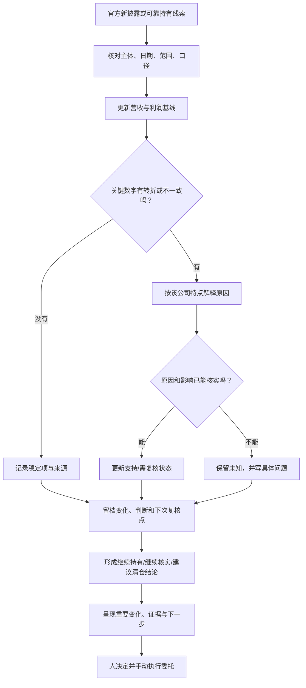

# 资产健康度通用卡与复核流程

更新日期：2026-10-23，v0.6。  
依据：腾讯、贵州茅台、苹果、拼多多四份首轮经营研究。目的不是把所有公司塞进相同指标，而是固定少量共同字段，再按生意特点补充解释。

四项资产各自的工作假设、关键监控项和逻辑受损复核条件已压缩到[四项资产决策卡](29-四项资产经营逻辑与清仓复核条件-2026-10-22.md)，后续逐季复用。

## 1. 四个样本检验出来的共同点

三家公司都能回答“收入规模怎样变化、利润是否持续赚出来”，但只看收入和利润同比会遗漏重要原因：

| 样本 | 表面变化 | 需要单独解释的原因 |
|---|---|---|
| 腾讯 | 营收、IFRS与non-IFRS利润走势不完全一致 | 投资收益、公允价值变化、资本投入与现金流 |
| 贵州茅台 | 2025收入和利润下降，2026H1营收微增但利润下降 | 营业成本、渠道改革、合同负债；财务公司存款影响经营现金流 |
| 苹果 | FY2026前三季度收入和利润增长加快 | iPhone与服务收入、区域汇率影响、关税退款和FY2024一次性税项 |
| 拼多多 | 2025收入继续扩大、净利润回落；2026H1收入和营业利润增长、净利润下降 | 线上营销与交易服务收入、销售/研发和生态投入、其他损益波动、竞争与贸易监管环境 |

四个样本都能使用同一条简明主线“收入规模怎样变化、利润是否持续赚出来”，但要按业务拆解增长原因。通用卡固定“变化、解释、证据、未知、复核”；不能把腾讯的调整后利润、茅台的合同负债、苹果的iPhone占比或PDD的交易服务收入、生态投入与其他损益变成所有公司的通用阈值。

## 2. 首版卡片：固定字段

### A. 资产身份与报告时点

- 公司/指数、证券代码、交易市场、呈报币种。
- 本次资料涵盖的报告期间、报告发布日期、股价/汇率日期（若展示估值）。
- 信息来源链接、原始来源或转述、数据口径及其置信程度。

### B. 为什么进入研究与当前经营认识

- 参考信号是谁或哪个机构披露、发生日期、信号类别（已执行买卖/明确持有/目标/13F/媒体转述）。
- 参考投资者持仓变化另保留申报主体、证券范围、报告日、公开日与股数差异；不把机构申报静默写成个人持仓，也不把滞后快照写成实时交易。
- 一句话业务说明和进入研究的理由。
- 该认识当前状态：**支持、需复核、未知**；附一条证据和下一问题。没有新消息不等于持仓没变化。

### C. 收入与利润两条主线

- 最近5个完整财年的营收和归母利润，标明同比与币种；按首尾计算的复合增速仅作历史描述。
- 最新可比报告期的营收、归母利润同比；年度、半年度、单季和TTM分开写。
- 如有多个利润口径，先并列，再解释差异；不得把调整后利润静默替代报表利润。
- 只要存在明显转折，就用一句话解释变化原因或标“原因未明”。

### D. 关键变化解释与证据状态

只保留能解释收入、利润、现金或原持有依据变化的少量业务特定字段。例如产品/地区、成本、现金流与资本开支、渠道与合同负债、汇率、投资收益、监管变化。每项变化标清：披露事实、公司解释、助手判断、未知问题。

状态标签：

- **支持：**最新证据仍与当前经营认识一致。
- **需复核：**出现重要变化，原因、持续性或口径尚未确认。
- **未知：**没有足够公开资料判断；缺资料不自动视为健康。

经营健康状态仍使用“支持、需复核、未知”；另设投资行动结论“继续持有、继续核实、建议清仓”。不设自动风险分数；清仓建议必须由已核实的逻辑失效证据支持，不能由未验证的百分比阈值自动触发。

### E. 下一次复核

- 下一份原始披露预期何时、来源在哪里。
- 下次只追踪的1—3个问题。
- 什么证据会支持原来的经营认识，什么证据会迫使重新研究。

### F. 估值独立呈现

若进行估值，另列市场价日期、股数日、汇率、TTM或预测利润口径和假设区间。单点市盈率是起点，不是结论；先核实盈利基础，再做保守/基准/乐观情景与年化回报敏感性，并给出假设来源和可信度。盈利质量、总回报门槛或安全边际规则未定时统一标“暂不分类”，不能只因低倍数称为便宜，也不能把未折现终值直接当合理现价。详细步骤见[估值区间与情景分析方法](26-估值区间与情景分析方法-v0.1.md)。估值状态不联动交易动作。

### G. 本轮投资行动结论

- **继续持有：**当前证据仍支持原有持有理由，且未发现需要退出的已确认变化。
- **继续核实：**出现重要变化或关键资料不足，暂时不能确认原逻辑是否失效；写明下一步要核实的证据。
- **建议清仓：**已确认买入依据对应的参考投资者减持，或企业经营/投资逻辑风险经可靠证据确认。用户已明确：一旦战略层确认该标的风险，清仓目标是该标的全部持仓，包括波段仓。说明证据、日期、范围和判断理由。个人波段规则不改写，现有挂单不自动撤改；提示活跃买单可能在清仓后成交并重新建仓。

这项结论是研究建议，由用户或家庭成员决定是否执行；首版不自动连接券商或下单。

### 行动结论的证据顺序

| 线索 | 需要核实什么 | 结论如何形成 |
|---|---|---|
| 参考投资者减持 | 是否为本人明确说明的已执行减持；资产是否确实以该投资者持有作为买入依据；记录证券、日期、数量与来源。机构申报需标明申报主体、报告日和披露日，不能当成个人实时交易 | 对应关系、范围与退出信号确认后进入清仓建议；战略风险确认后的目标为该标的全部持仓。公开证据只是滞后机构快照时先继续核实，不把未披露部分补成事实；波段规则和已有委托不自动改变 |
| 企业或投资逻辑风险 | 对照原来的选入理由，核对官方财报、公告等原始证据；判断变化是否实质动摇关键理由，区分一次性波动、资料不全和持续/结构性变化 | 原逻辑已被可靠证据实质推翻时，建议清仓该标的全部持仓；原因或持续性不清时继续核实；原逻辑仍获支持时继续持有 |
| 股价下跌 | 先判断有无企业逻辑或参考持有人变化的证据 | 单纯价格下跌不构成止损信号；不因价格本身建议清仓 |
| 估值明显偏高或快速上涨 | 将价格与经营、估值依据分开，按用户现有战术规则观察持仓减持；估值分类仍受盈利情景、回报门槛和安全边际规则限制 | 可以形成估值/战术层面的减仓或退出判断，但目前没有统一估值阈值；不得把“暂不分类”伪装成高估，也不得用其替代逻辑风险核查 |

不设机械的营收或利润跌幅清仓线。每次由助手说明证据与原投资理由的关系、影响的持续性和判断可信度，再给出行动结论；后续用真实披露案例逐步校准边界。

## 3. 每次更新的工作流

执行顺序固定：取源 → 校对可比期间 → 更新关键数字 → 解释差异 → 改状态或保留未知 → 设下一次复核点。除财报外，CEO更替等可能影响原有经营判断的重要公司事件也可触发一次定向复核；先记录事实与日期，不把事件本身直接翻译成健康度结论。未发现重要变化时，不为制造更新而打扰用户。

## 4. 与用户交易方法的连接

经营健康卡回答“公司发生了什么、原来为何研究、原逻辑是否仍成立”；交易循环回答“如何安排买单与卖单”。每次健康复核都要给出“继续持有、继续核实、建议清仓”之一。参考投资者减持先核实其是否构成该资产的买入依据；战略层风险一旦确认，明确建议清仓该标的全部持仓。个人波段规则不变，现有挂单不自动撤改；清仓后活跃买单可能成交并重新建仓，报告必须提醒。证据不足则继续核实。报告应列来源、事实日期、披露日期、范围和可信度。首版不自动交易，家人手动维护一买一卖并在开盘、尾盘调整挂价。自动读取账户与价格提醒尚未接入。

## 5. 产品化的当前最小形态

从四份样本可抽出的首版服务是：

1. 用户维护少量研究/持有资产及认可的参考来源。
2. 助手读取公开原始材料，保存报告日期、数字口径和来源。
3. 系统按各公司特点解释变化，标明支持、需复核或未知。
4. 用户收到值得处理的变化、证据和持有结论；日常无变化则保持安静。结论不等同自动交易。

先用人工更新验证这套输出是否有帮助。PDD下一份季度业绩日期待公司正式公告；茅台2026Q3和苹果FY2026年报也将在各自正式披露后按同一模板重跑。至少再完成两轮变化更新，确认能稳定减少重复研究后，再定义自动化、通知频率和技术接口。段永平雪球发言的固定季度抓取或提醒先不开发；当前也不安装新的外部投研工具、不连接券商账户。

## 6. 目前仍待验证

- “5年营收与利润 + 最新披露”的组合是否已足够简洁且能区分周期变化与结构性变化。
- 平时主动检查公开持有变化的频率和覆盖范围，能否满足家庭低打扰监控；公开披露空档必须如何显示。
- “重大变化”的哪些定义值得提醒，应以真实更新样本建立，而不是预先发明通用百分比阈值。
- 财报以外的管理层、治理或战略变化，是否能用低打扰的方式纳入监控；苹果CEO交接将作为第一个样本观察。
- 估值卡和用户的战术挂单卡在界面上如何并列展示，避免让用户把一类信号当成另一类指令。

因此这份文档是研究流程的首版规范，不是已上线的软件规格。是否有用要靠后续真实更新验证。
