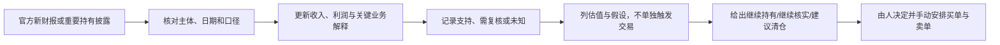

# 四项资产研究总览

更新日期：2026-10-22，v0.5。用途：把当前四项样本压缩成便于家庭定期查看的首屏，不替代详细研究卡。每次更新需给出持有结论，委托由人手动执行。

如果只需快速看财务初筛，先看[四项资产财报快筛](28-四项资产财报快筛-2026-10-22.md)：本阶段只比较公司最新财报营收和利润，不要求用户自行做复杂公司分析。下面保留参考来源、经营问题、估值和下次复核等详细底稿。

每项资产为什么留在样本、什么变化只触发核实、什么证据可能动摇原逻辑，见[四项资产经营逻辑与清仓复核条件](29-四项资产经营逻辑与清仓复核条件-2026-10-22.md)。

## 先看结论

**截至2026-10-22的人工披露复核已完成：**四家公司的官方页面均未出现比当前财报基线更新的季度业绩；H&H和伯克希尔Q3 13F尚未到申报期限。腾讯另于10月完成美元和人民币票据发行，已列为Q3现金、负债及资金用途核查项；该事项本身未触发清仓。每周自动检查仍待下一次定时运行验证；详见[披露更新验证](31-2026-10-22公开披露更新验证.md)。

四项资产都已完成首轮经营研究，并已有一个报表滚动市盈率快照；但完整估值结论尚未完成。按各自最新可用数据粗看，腾讯约11.2倍non-IFRS TTM市盈率、茅台约20.1倍报表EPS口径TTM、苹果约39.5倍GAAP TTM、PDD约8.5倍GAAP TTM。价格日期、会计口径与利润质量不同，这些倍数不能直接横向排序，更不能单独判定谁便宜。当前最需要复核的经营问题是贵州茅台的收入与利润放缓，以及拼多多2026Q2其他损益大幅转负的原因。苹果近期增长较快，但需观察关税退款影响；腾讯的营收和利润仍增长；H1净现金变化与10月新增票据需在Q3合并核对。

“支持”表示当前经营证据尚支持原认识，不表示价格合适；“需复核”表示有重要变化或原因未明，不等于应卖出；“未知”表示公开资料不足。“继续核实”是本次首轮研究结论，不表示已启动实时监控；有确认的参考持有人卖出或逻辑失效证据时，再明确建议清仓。参考持仓、经营健康与估值分别判断。

## 当前快照

| 资产 | 参考依据及边界 | 最新经营数据 | 经营状态 | 本轮行动结论 | 估值状态 | 当前最重要的未解问题 | 下一复核触发 |
|---|---|---|---|---|---|---|
| 腾讯（0700） | 用户实际操作；段永平有日期明确的历史持有自述，但截至2026-10-20未核实到更新。腾讯港股不在H&H/伯克希尔13F覆盖范围内，不能用13F缺席推断卖出 | 2026H1：营收约+10.1%，IFRS及non-IFRS利润均约+10% | **支持经营延续；资本结构需复核** | **继续核实**：无已确认清仓依据；尚无可见的最新本人持仓证据，Q3核验现金投入与10月新增票据 | 更新至2026-10-21收盘HK$393.80；按2026H1滚动TTM利润、6月末股数与当日汇率近似，IFRS约12.9倍、non-IFRS约11.2倍。估值仍暂不分类 | H1末净现金与10月新增票据后的现金、借款/票据及利息；算力投入是否带来相称收入和回款 | 腾讯官方安排2026-11-18 20:00（香港时间）发布2026Q3业绩；复核营收、双口径股东利润、净现金、借款与票据、财务费用及AI投入。[腾讯投资者日历](https://www.tencent.com/investors/investor-kit-calendar/) |
| 贵州茅台（600519） | 段永平2025年公开访谈列为重要持股；2026-09-28买入3万股有同期媒体转引截图支持，原帖未直取；暂无可确认的后续卖出 | 2026H1：营收+1.47%，归母净利润-1.95%，营业成本+21.81%；2025年收入与利润均下降 | **需复核** | **继续核实**：有一笔买入线索，但经营放缓尚未证实为逻辑失效；不推算当前总持仓 | 2026-10-21收盘价¥1,309.69；报表滚动EPS约¥65.05，对应**约20.1倍报表TTM市盈率**；未判断合理估值区间 | 终端需求、渠道改革与成本变化能否使利润重新稳定 | 第三方证券日历显示三季报预约日为2026-10-31；官方财报目录仍以H1为最新，预约日期待公告确认。[贵州茅台官方财报目录](https://www.moutai.com.cn/mtgf/tzzgx/cwbg/index.html) |
| 苹果（AAPL） | 段永平本人公开谈及持有；伯克希尔与H&H是分开的申报主体。伯克希尔Q2 13F苹果股数与Q1相同；H&H Q2申报股数环比减少约6.4%，属部分减持线索，不等于段永平个人清仓。[伯克希尔Q2申报](https://www.sec.gov/Archives/edgar/data/1067983/000119312526352200/xslForm13F_X02/56757.xml) · [H&H Q2申报](https://www.sec.gov/Archives/edgar/data/1759760/000175976026000007/xslForm13F_X02/infotable.xml) | FY2026前三季度：营收+16.1%，净利润+20.0%；Q3毛利率与EPS受关税退款帮助 | **目前支持增长；一次性影响与管理层交接待复核** | **继续核实**：伯克希尔申报未变、H&H部分减持；确认的只是两个机构组合快照，不是巴菲特或段永平个人实时交易，需结合实际买入依据判断 | 2026-10-21收盘价$344.09；报表滚动摊薄EPS约$8.72，对应**约39.5倍GAAP TTM**；扣除Q3每股$0.11关税退款后约$8.61，对应约40.0倍 | 不含关税退款的盈利趋势是否仍强；大中华区、服务增长及新CEO资本配置 | 苹果IR安排2026-11-02 FY2026Q4业绩电话会；报告发布后复核。[Apple Investor Relations](https://investor.apple.com/investor-relations/) |
| 拼多多（PDD） | 段永平2025年雪球官方访谈谈及持有并提醒风险；H&H Q2 13F股数较Q1增加约26.7%，伯克希尔Q2 13F未列PDD。两项均限于相应公开披露范围，不代表段永平个人当前持仓。[H&H Q2申报](https://www.sec.gov/Archives/edgar/data/1759760/000175976026000007/xslForm13F_X02/infotable.xml) · [伯克希尔Q2申报](https://www.sec.gov/Archives/edgar/data/1067983/000119312526352200/xslForm13F_X02/56757.xml) | 2026H1：营收+9.5%，营业利润+13.0%，净利润-12.7%；其他收入/损失Q1、Q2连续为负，H1同比不利摆动人民币128.10亿元 | **需复核盈利持续性** | **继续核实**：H&H申报增持，不构成清仓信号；经营利润与净利润分化仍未解释 | 2026-10-21约8.5倍滚动GAAP摊薄市盈率；不能据倍数直接判便宜 | Q3是否延续/逆转及后续附注能否解释其他损益 | PDD官方季度业绩页尚未列出Q3安排；等公司公告。[PDD官方季度业绩页](https://investor.pddholdings.com/financial-information/quarterly-results/) |

## 下次更新怎么跑

当前参考持有快照已与财报基线合并：H&H截至2026-06-30的申报中苹果股数环比减少约6.4%、PDD增加约26.7%；伯克希尔苹果申报股数不变、未申报PDD。它们都是滞后的机构组合数据。段永平个人持仓方面，腾讯只有历史公开自述，茅台只有一笔媒体转引买入，苹果和PDD的个人当前仓位均不能由13F代替。故本轮没有把机构申报直接写成个人卖出或自动清仓。接下来按公司正式披露更新财报；每周任务跟踪新13F与公司报告，段永平雪球发言的季度跟踪仍暂缓。

## 样本卡与证据来源

- [腾讯资产健康度监控卡](12-腾讯资产健康度监控卡.md)
- [贵州茅台经营健康度初筛](14-贵州茅台经营健康度初筛-2026H1.md)
- [苹果经营健康度初筛](15-苹果经营健康度初筛-FY2026Q3.md)
- [拼多多经营健康度初筛](24-PDD经营健康度初筛-2026H1.md)
- [通用资产健康度卡与复核流程](16-资产健康度通用卡与复核流程.md)
