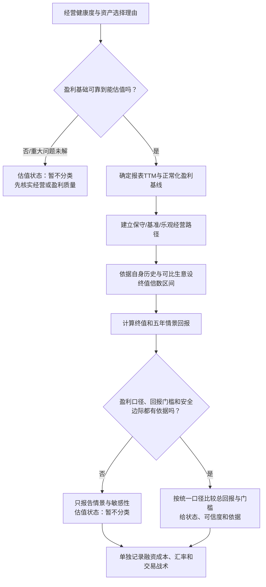

# 估值区间与情景分析方法

版本：v0.2；更新日期：2026-10-22。用途：把“估值适中或偏低才考虑建仓”转成能重复说明、复核和修订的分析步骤。它用于战略判断，不自动产生买卖指令，也不代替用户的价格挂单规则。

## 一、为什么不能只看一个市盈率

市盈率把当前价格和过去利润放在一起，却没有说明利润能否维持、未来增长怎样、合理估值倍数多少。相同的8倍市盈率，对利润稳定且现金充足的生意，和对利润正在下滑或一次性收益占比较大的生意，含义不同。因此总览里的TTM市盈率是起点，不是结论。

## 二、首版估值流程

### 1. 先过盈利可靠性门槛

只要存在会显著改变可持续盈利的未解事项，就先标“估值暂不分类”，不能因为市盈率低而直接叫作便宜。比如利润大幅受投资损益影响、经营利润与净利润背离、持续降价或关键成本上升，都要先查原因。

### 2. 建立盈利基线，不把调整项藏起来

保留最新报表TTM利润或摊薄EPS，并与最近五年年度数据和最新季度趋势对照。明确披露的一次性项目可以做正常化分析，但必须同时展示报表值、调整值、调整依据和结果差异；证据不足时保留原值并降低估值可信度。优先使用每股盈利，能反映回购、增发和股权激励导致的股数变化。

### 3. 用三个经营情景代替单一增长预测

保守、基准、乐观情景要分别说明收入增长、利润率、每股盈利和资本回报从何而来。历史增长率只用于校准，不能直接当未来增速；每个情景至少写一条可观察的支持证据和一条会推翻它的条件。情景不强行赋予概率，避免伪精确。

### 4. 终值倍数要有出处

终值市盈率或自由现金流倍数以公司自身完整周期区间、业务结构和可比公司为参照。剔除明显异常的市场阶段并说明理由；找不到合适可比对象时扩大区间，不制造精确目标价。对腾讯等多业务公司，若不能可靠拆分分部价值，就先用整体公司情景，不机械扣除被投公司账面价值。

### 5. 算区间和年化回报

简化的五年情景可写为：

`五年后每股盈利 = 当前正常化每股盈利 × (1 + 情景增速)^5`

`五年后价格 ≈ 五年后每股盈利 × 终值估值倍数`

`年化价格回报 = (五年后价格 ÷ 当前价格)^(1/5) - 1`

该公式只算价格回报。股息、汇率、税费和融资利息分别列示，不能混进经营增长假设；涉及海外资产时，另示当地货币回报和人民币口径结果。在这些项目尚未并入前，不把价格回报与投资者的总回报门槛直接比较。最终先输出保守/基准/乐观情景范围，不把中位数冒充预测。

### 6. 估值状态与可信度

**估值状态标签暂不启用。**仅把当前价格与五年后的未折现情景价格比较，不能推出当前“偏低／适中／偏高”；同样，五年价格回报也不是完整总回报。要启用标签，至少还需明确适用于家庭资金的总回报门槛、安全边际规则，并统一计入股息、税费、汇率及投资期限；这些标准不能由分析者暗中代替用户设定。

在标准补齐前，每项资产先报告保守／基准／乐观的价格回报敏感性、未计项目、盈利判断可信度和最敏感的两项假设，状态统一写“暂不分类”。即使将来启用标签，它也只是对公开证据和假设的研究判断，不保证价格回归，也不直接改变用户交易计划。

## 三、四项样本当前的估值准备度

| 资产 | 已有事实基线 | 估值前主要工作 | 当前状态 |
|---|---|---|---|
| 腾讯 | 五年收入、IFRS与non-IFRS利润；TTM两种口径；已有5年盈利增长×终值倍数敏感性表 | 解释未来盈利增长与现金投入、回购及投资组合的关系；统一股价日期后更新情景 | 可作为首个方法样本；尚未形成便宜/适中/偏高结论 |
| 贵州茅台 | 五年及TTM报表EPS；2025与2026H1减速；滚动市盈率约20.1倍 | 先用Q3及渠道、成本证据判断利润是否企稳，再设正常化盈利 | 经营状态需复核；目前不贴便宜标签 |
| 苹果 | 五年及FY2026前三季度收入利润；报表滚动摊薄EPS约$8.72；约39.5倍报表P/E | 已用公司披露的每股$0.11关税退款做单项敏感性：扣除后TTM EPS约$8.61、P/E约40.0倍；仍需检视新CEO下产品与服务增长及完整正常化盈利 | 单项退款调整只改变约0.5倍P/E，不是主要估值结论；经营增长支持研究，整体情景仍待完成 |
| 拼多多 | 五年与TTM EPS；2026H1营业利润+13.0%、净利润-12.7%；其他收入/损失Q1、Q2连续为负，H1同比不利摆动人民币128.10亿元 | 已查公司Q2 SEC 6-K及2025年20-F，均未披露本期损失构成；下一步等待Q3走势和后续经审计附注 | 关键盈利质量仍未解；暂不以GAAP TTM EPS推断常态盈利，更不得因低倍数判便宜 |

腾讯的现有模型可作计算格式模板：在多组每股盈利增速和终值市盈率下列示五年年化价格回报，见[腾讯多年经营与估值初筛](11-腾讯多年经营与估值初筛.md)。截至2026-10-21，公开数据供应商列出的腾讯近五年年末P/E约14.2—22.3倍、均值约18.4倍，近十年年末均值约25.8倍；该序列的EPS期间/摊薄口径不完整披露，历史价格与EPS也未经独立复核，且对应历史报表P/E而非未来终值倍数。另一公开供应商公布的五年平均值也不同。因此这些数据只能提示历史估值背景，不能直接把某个均值设为终值倍数。腾讯模型中5%／8%／12%增速和10／12／15倍终值市盈率仍属敏感性演练输入，未由可比口径历史区间和经营驱动完成校准，不能用于估值分类。后续每项资产都使用自己的盈利基线和有出处的假设，不共用同一增速或终值倍数。

本轮敏感性推进只对盈利调整有公司直接量化依据的苹果做了单项校正：报表P/E约39.5倍，扣除每股0.11美元退款后约40.0倍。这个改动不提供合理估值区间。腾讯继续沿用已有的探索性情景表；茅台需在下一份财报确认利润是否企稳；PDD的财报质量追查已完成当前公开资料范围内的核验：2025年20-F给出2023—2025年“其他收入，净额”年度总额及一般性说明，2026Q2的6-K附件仍未拆分2026Q1—Q2损失。没有证据足以把该项正常化为零，PDD暂不进入可依赖GAAP TTM盈利的估值情景；待下一份报告提供新证据后再决定能否通过盈利可靠性门槛。未具备可验证的正常化盈利和终值假设时，不为凑齐四项而编造敏感性区间。

## 四、和融资、交易策略的边界

估值回答“经营假设下，当前价格隐含什么回报”；短、中、长期买卖与挂单规则回答“用户怎样持有和交易”。融资成本、融资期限、担保比例和压力下的资金需求放在组合与杠杆层单列。高杠杆不会让资产本身更便宜，低估值也不代表可承受任意杠杆。

## 五、这一版如何验证

先以腾讯既有情景表校准字段；当前终值倍数缺少可比口径的完整历史序列，且收益门槛与安全边际未定义，因此只能作为敏感性演练，不能给“偏低／适中／偏高”结论。下一轮按茅台正式三季报披露后复核经营与盈利基线，再把同一格式应用于苹果和PDD。两轮真实财报更新后检查情景解释是否可复算、假设是否容易被新证据修正，以及一页结果是否足以帮助用户判断。此方法尚未证明估值状态标签有效，现阶段人工研究，不运行自动提醒或自动交易。
