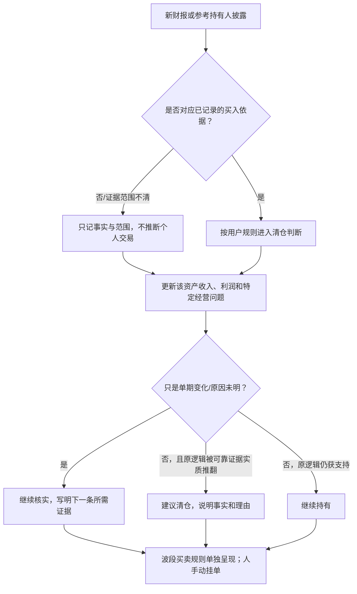

# 四项资产的经营逻辑与清仓复核条件

更新日期：2026-10-22，v0.1。目的：把“监控资产健康度”落到每项资产的少数关键问题，避免把任何一次利润下滑、投资者持仓快照或股价波动直接变成清仓指令。

本文是根据现有研究底稿整理的**助手工作假设**，不是用户逐项确认过的完整投资论点。它先用于统一后续财报检查；遇到新事实时按原始证据更新。用户已确认参考持有人减持只影响清仓判断，不影响个人波段交易；价格下跌本身不是止损依据。

## 四项资产先看什么

| 资产 | 进入当前样本的依据 | 每次复核最先看 | 出现什么先复核，而非直接卖出 | 什么证据可能确认原逻辑实质受损 | 当前状态 |
|---|---|---|---|---|---|
| 腾讯 | 用户已有实际交易经验；段永平有历史公开持有表述。腾讯本身收入规模大、持续盈利 | 营收、IFRS与non-IFRS利润；主要业务的收入与利润能否增长；大额投入是否逐步带来经营回报 | 收入与利润增速分化、投入增加但短期回报未见、现金流口径变化；2026年10月新发行美元及人民币票据，需与H1净现金下降一起核对 | 主要服务竞争力持续走弱，收入与利润的长期增长能力被可靠资料否定；或投入持续扩大却无法转成业务回报并明显损害盈利能力。单独的票据发行不是逻辑失效证据 | 收入及利润增长；现金投入、净现金与新增负债的用途和影响继续跟踪。未见明确清仓依据 |
| 贵州茅台 | 段永平公开买入线索（原帖未直接核验）；品牌、产品与利润规模是研究起点 | 收入与净利润；茅台酒/系列酒、直销/批发结构；营业成本、渠道和消费者动销证据 | 收入近乎持平而利润下降、成本快于收入、合同负债或现金流变化。先区分渠道改革、财务公司资金和真实终端需求 | 可靠证据显示消费者需求、品牌定价能力或渠道销售长期受损，且不再是短期改革过渡；利润承压持续并由经营事实印证 | 2025及2026H1转弱，需求与改革效果尚未查明；继续核实 |
| 苹果 | 段永平公开谈及持有；伯克希尔为另一参考主体。设备生态和服务业务是研究起点 | 总营收与利润；iPhone和服务；活跃设备基础；大中华区；剔除一次性因素后的毛利与盈利趋势 | iPhone、服务、区域增长分化；关税退款等一次性项目抬高利润；CEO交接。单个事件不自动等于逻辑改变 | 设备生态或用户黏性出现持续、可核实的削弱；服务业务未能形成原先的增量支撑；监管/竞争或资本配置变化长期损害盈利模式 | 近期收入和利润增长，但一次性退款与新任CEO的经营策略需复核；无已确认的相关个人减持 |
| 拼多多 | 段永平2025年公开访谈谈及持有，同时明确提示风险；平台规模与商家生态是研究起点 | 营收、营业利润、净利润并列；营销/研发及生态投入；其他损益；商家、消费者与跨境经营 | 营业利润增长但净利润下降；“其他收入/损失”大幅波动；增长放缓或投入上升。原因未明时保留未知 | 公开证据显示平台竞争优势、消费者/商家参与或投入回报持续恶化，导致规模无法转成可持续盈利；或跨境经营条件根本改变 | H1营收和营业利润增长、净利润下降；其他损益来源未明；继续核实 |

“可能确认原逻辑受损”是复核方向，不是预设阈值。本文不使用单季跌幅、固定营收增速或市盈率倍数自动判定清仓；一次变化先核对口径、持续性和公司解释。

## 每次更新按同一顺序出结论

执行规则：

1. **参考持仓流：**先分清本人表述、机构申报和媒体转引，再核对资产是否以该参考持有作为已记录的买入依据。确认的减持只进入清仓判断；它不改变用户自己的涨幅卖出、回撤买入和手动挂单。公开申报的机构变化不能冒充个人实时交易。
2. **企业健康流：**按财报期间对照营收、利润和该公司的关键解释项。一次异常先“继续核实”；只有可靠证据足以确认原经营逻辑实质改变，才“建议清仓”。
3. **价格与估值流：**股价下跌不触发止损；估值暂不分类时也不假装高估或低估。价格波段操作继续按用户现有规则独立运行。
4. **输出：**每项资产每次只给一个行动结论——继续持有、继续核实、建议清仓——再附一条主要证据、一条未知和下一次复核点；没有重要变化时不打扰。

## 本轮套用后的简表

按2026-10-22已核实的最新财报、机构持仓快照和公司公告，四项都没有出现足以确认“原逻辑已失效”的新证据。茅台和PDD因盈利趋势或盈利质量问题继续核实；腾讯和苹果近期报告中的收入、利润增长仍支持经营延续，但腾讯的H1净现金下降与10月新增票据需在Q3合并复核，苹果的一次性退款和管理层交接继续观察。参考持仓方面，H&H的苹果减持属于机构季度变化，不能代替段永平本人卖出；伯克希尔苹果股数未变。故本轮没有建议清仓，不代表保证资产健康或价格合适。

## 后续复用来源

- [资产健康度通用卡与复核流程](16-资产健康度通用卡与复核流程.md)
- [四项资产研究总览](25-四项资产研究总览-2026-10-21.md)
- [四项资产财报快筛与披露扫描](28-四项资产财报快筛-2026-10-22.md)
- [腾讯经营基线](05-腾讯生意理解与定期复核基线.md)、[茅台经营初筛](14-贵州茅台经营健康度初筛-2026H1.md)、[苹果经营初筛](15-苹果经营健康度初筛-FY2026Q3.md)、[PDD经营初筛](24-PDD经营健康度初筛-2026H1.md)
